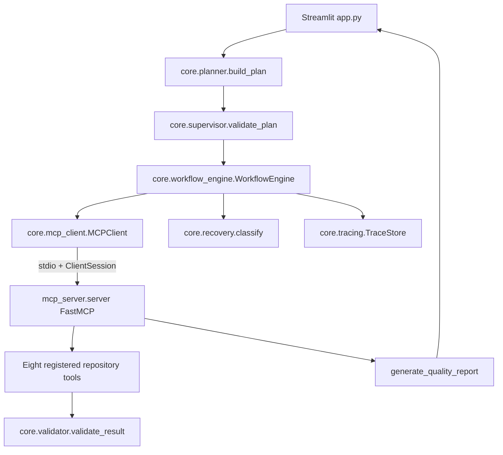

# DevFlow MCP: An MCP-Based Intelligent Developer Workflow Orchestrator for Repository Health and Release Readiness

## 1. Project Title

**DevFlow MCP: An MCP-Based Intelligent Developer Workflow Orchestrator for Repository Health and Release Readiness**

## 2. Aim

To design and implement a developer automation system using the Model Context Protocol (MCP), in which a Streamlit application converts a repository-audit request into a validated workflow, communicates with a separate FastMCP server over stdio, discovers and invokes repository-analysis tools, executes independent tasks concurrently, respects task dependencies, validates results, records traces, performs a measured performance comparison, and generates a repository-health report.

The project extends the faculty's calculator-oriented demonstration into a repository-quality and release-readiness use case. The implemented application is deterministic and offline; it does not require a Gemini API key or another paid service.

## 3. Objectives

| Faculty objective | Status in the implementation | Evidence |
|---|---|---|
| Understand MCP architecture | Implemented | Separate `MCPClient` and FastMCP server communicate over stdio. |
| Implement an MCP server in Python | Implemented | `mcp_server/server.py` creates `FastMCP` and registers eight tools. |
| Implement an MCP client using `ClientSession` | Implemented | `core/mcp_client.py`. |
| Establish client-server communication using stdio | Implemented and integration-tested | `stdio_client`, `StdioServerParameters`, and `ClientSession` are used in the real integration tests. |
| Dynamically discover MCP tools | Implemented and integration-tested | `session.list_tools()` returns the live registry. |
| Execute developer tools through MCP | Implemented | Repository operations are invoked with `session.call_tool()`. |
| Implement a Planner Agent | Implemented as a deterministic rule-based planner | `core/planner.py`; it is not an unrestricted LLM planner. |
| Implement a Supervisor Agent | Implemented | `core/supervisor.py` checks discovered tools, dependencies, policies, and cycles. |
| Implement safety and policy validation | Partially implemented | Tool allow-list, test approval, command-key rejection, and server-side path security exist. `config/policies.json` is present but is not dynamically loaded by the policy module. |
| Demonstrate sequential and parallel execution | Implemented | The workflow batches ready tasks with `asyncio.gather`; the benchmark compares sequential and parallel calls. |
| Implement dependency-aware execution | Implemented | Tasks wait for dependency states in `WorkflowEngine.execute`. |
| Validate tool results | Implemented | `core/validator.py` checks required result fields by tool. |
| Implement validation and failure recovery | Partially implemented | Failure classification and bounded retry decisions exist; retryable workflow failures are returned to `pending`. |
| Implement execution tracing | Implemented for workflow task outcomes | `TraceStore` appends JSONL task events to `logs/mcp_traces.jsonl`. |
| Implement structured application logging | Partially implemented | `configure_logging()` exists, but it is not called by the current application path. |
| Analyze execution performance | Implemented and benchmarked | `core/performance.py` records actual samples and writes `reports/benchmark.json`. |
| Generate a structured developer automation report | Implemented | The MCP report tool returns structured findings, status, score, categories, and release-gate state. |
| Provide five independent Streamlit pages | Partially implemented | `pages/` contains five files, but the active `app.py` radio exposes three views; the page files are lightweight auxiliary views. |

## 4. Tools and Technologies Used

| Technology/library | Purpose | Actual location |
|---|---|---|
| Python | Core implementation, AST analysis, subprocess execution, models, orchestration | All Python modules |
| `mcp` Python SDK | MCP protocol implementation | `mcp_server/server.py`, `core/mcp_client.py` |
| FastMCP | Server object and decorated tool registration | `mcp_server/server.py:22`, `@mcp.tool()` |
| `ClientSession` | MCP session initialization, discovery, and calls | `core/mcp_client.py:8,20-27` |
| stdio transport | Starts the MCP server as a separate Python process | `core/mcp_client.py:20` |
| `asyncio` | Async client operations, bounded workflow batches, and benchmark concurrency | `core/workflow_engine.py`, `core/performance.py`, `app.py` |
| Streamlit | User interface, controls, session state, metrics, and downloads | `app.py`, `pages/` |
| `pytest` | Sample project tests and DevFlow unit/integration tests | `requirements.txt`, `tests/` |
| `pytest-asyncio` | Async MCP and workflow integration tests | `requirements.txt`, `tests/integration/` |
| `ruff` | Deterministic lint validation | `requirements.txt`, validation command |
| `ast` | Static Python syntax, function, class, and import analysis without executing inspected code | `mcp_server/server.py:1,96-132` |
| `subprocess` | Fixed pytest subprocess execution | `mcp_server/server.py:165-170` |
| JSON | Structured MCP results and report exports | `server.py`, `core/reporting.py` |
| JSONL | One-event-per-line persistent workflow trace format | `core/tracing.py`, `logs/mcp_traces.jsonl` |
| Python logging | A logging configuration helper exists | `core/tracing.py:9-12`; not invoked by the current UI path |
| `pathlib` | Canonical path resolution and containment checks | `mcp_server/security.py` |

The direct dependency declarations are in [requirements.txt](requirements.txt):

```text
mcp>=1.9,<2
streamlit>=1.40,<2
pytest>=8,<9
pytest-asyncio>=0.24,<1
ruff>=0.8,<1
```

## 5. Theory

### 5.1 Model Context Protocol

MCP is a standardized protocol for exposing external capabilities as discoverable tools. In DevFlow MCP, repository operations are not called directly by Streamlit. The Streamlit-side orchestration uses `MCPClient`, which starts the server and communicates with it using the MCP protocol.

### 5.2 MCP client-server architecture

The client process is the Python process running the Streamlit application or a test. It starts a separate server process using `sys.executable -m mcp_server.server`. The server owns the repository tools and returns structured responses. This separation demonstrates the faculty's client-server architecture.

### 5.3 FastMCP and tool registration

`FastMCP("DevFlow MCP Server")` creates the server. Functions decorated with `@mcp.tool()` become MCP tools. Their Python type annotations are used by the SDK to describe tool inputs.

### 5.4 `ClientSession` and stdio transport

`stdio_client` creates asynchronous read and write streams. `ClientSession` uses these streams, and `await session.initialize()` performs MCP session initialization. The context managers close the session and transport after calls complete.

### 5.5 Dynamic discovery and invocation

`await session.list_tools()` obtains the live tool definitions from the running server. `await session.call_tool(name, arguments)` invokes a discovered tool. The integration test verifies that the eight returned names are the actual server registry.

### 5.6 Planner and Supervisor

The Planner is deterministic and rule-based. It recognizes requests containing terms such as `audit`, `quality`, `test`, `repository`, `code`, or `release`, and creates `Task` objects. The Supervisor checks tool availability, dependency IDs, policy decisions, and cycles before execution.

### 5.7 Safety and policy validation

The policy module allows only the eight known tool names, rejects arbitrary command keys, and requires `approved=True` for test execution. The server applies a stronger final boundary through canonical path validation.

### 5.8 Parallel and dependency-aware execution

Tasks without dependencies are placed in the same ready batch and run through `asyncio.gather`. A test task depends on test-inventory completion. The report task depends on all tasks created before it.

### 5.9 Result validation and recovery

The validator checks that a result is a dictionary and contains tool-specific fields. Recovery classifies security/input failures as non-retryable, permits selected communication failures to retry, and avoids retrying the test runner on timeout.

### 5.10 Path security and timeout protection

The server resolves project paths and file paths, checks containment, rejects sensitive names and private-key extensions, skips symlink escapes during file enumeration, and applies file/result limits. Test subprocesses use a bounded timeout and `shell=False`.

### 5.11 Structured logging and JSONL tracing

`TraceStore.append()` serializes each task event as an independent JSON object. The trace includes IDs, tool name, safe argument keys, state, duration, retry count, validation state, dependencies, execution mode, and timestamp. A logging helper exists but is not currently called.

### 5.12 Performance monitoring

The benchmark uses `time.perf_counter()` for both modes, calculates statistical summaries, and writes the result to `reports/benchmark.json`.

### 5.13 Python AST and pytest

The AST tool parses Python files without executing them and reports syntax errors, functions, classes, imports, source lines, function lengths, and missing function docstrings. The test tool executes a fixed `sys.executable -m pytest` command against validated targets.

### 5.14 Streamlit

Streamlit provides the workflow request field, approved project path field, plan display, tool discovery view, benchmark controls, light-mode toggle, readiness metric, and report download buttons.

## 6. System Architecture and Workflow

### 6.1 Actual call path

1. `app.py` accepts a project path, request text, and test checkbox.
2. `build_plan()` creates a `Plan` containing `Task` objects.
3. `MCPClient.discover_and_call([])` starts the separate MCP server and calls `session.list_tools()`.
4. `validate_plan()` checks the plan against discovered tool names, dependencies, policy, and cycles.
5. `WorkflowEngine.execute()` repeatedly identifies tasks whose dependencies are complete.
6. Ready tasks call `MCPClient.call()`.
7. `MCPClient` starts a genuine stdio session, initializes it, discovers tools, and invokes the requested tool.
8. The server validates project/file boundaries and performs the repository operation.
9. The client decodes structured MCP content and the workflow validator checks required fields.
10. Successful results are stored under task IDs.
11. `generate_quality_report` aggregates those result payloads.
12. `TraceStore.append()` persists the task event.
13. Streamlit displays the score/status and provides JSON, Markdown, and CSV downloads.

### 6.2 Architecture diagram



### 6.3 Important implementation limitation

The repository-tool calls do pass through the real MCP boundary. However, the current `MCPClient.call()` creates a new server/session for each individual tool call. The workflow is still MCP-correct, but it does not reuse one long-lived MCP session across the whole workflow.

## 7. Main Implementation Code Snippets

### Snippet 1 — FastMCP server initialization and registration

**Source:** `mcp_server/server.py:22,47-58`

```python
mcp = FastMCP("DevFlow MCP Server")


@mcp.tool()
def list_project_files(project_path: str, max_depth: int = 6, limit: int = 500) -> dict[str, Any]:
    root = project_root(project_path)
    files = _files(root, max(0, min(max_depth, 20)), max(1, min(limit, 2000)))
    suffixes: dict[str, int] = {}
    for path in files:
        suffix = path.suffix.lower() or "[no extension]"
        suffixes[suffix] = suffixes.get(suffix, 0) + 1
    return {"status": "success", "files": [relative(p, root) for p in files],
            "file_count": len(files), "directory_count": len({p.parent for p in files}),
            "file_types": suffixes}
```

This creates the server and registers `list_project_files` through the decorator. The other seven tools use the same decorator.

**Faculty requirement:** MCP server implementation and developer-tool exposure.

### Snippet 2 — MCP client and stdio connection

**Source:** `core/mcp_client.py:8-23`

```python
from mcp import ClientSession, StdioServerParameters
from mcp.client.stdio import stdio_client

params = StdioServerParameters(command=sys.executable, args=args, env=None)
async with stdio_client(params) as (read, write), ClientSession(read, write) as session:
    await session.initialize()
    tools = await session.list_tools()
```

`sys.executable` makes the child process use the active Python interpreter. The nested asynchronous context managers ensure transport and session cleanup.

**Faculty requirement:** ClientSession and stdio client-server communication.

### Snippet 3 — Dynamic MCP tool discovery

**Source:** `core/mcp_client.py:21-23`

```python
await session.initialize()
tools = await session.list_tools()
names = [tool.name for tool in tools.tools]
```

The registry is obtained from the live server. The Streamlit Tool Explorer reports the length of this list rather than using a UI-only hardcoded count. `tests/integration/test_mcp_stdio.py` verifies the exact eight names.

**Faculty requirement:** dynamic tool discovery.

### Snippet 4 — MCP tool invocation and response decoding

**Source:** `core/mcp_client.py:25-47`

```python
for name, arguments in calls:
    response = await session.call_tool(name, arguments)
    results.append(_decode(response))


def _decode(response: Any) -> dict[str, Any]:
    if getattr(response, "isError", False):
        message = "MCP tool returned an error"
        for content in getattr(response, "content", []):
            message = getattr(content, "text", message) or message
        raise RuntimeError(message)
    if getattr(response, "structuredContent", None):
        return response.structuredContent
```

The client sends the tool name and argument dictionary through MCP. Error-shaped responses are raised instead of being silently accepted as successful results.

**Faculty requirement:** tool execution and failure handling.

### Snippet 5 — Deterministic Planner

**Source:** `core/planner.py:8-33`

```python
def build_plan(request: str, project_path: str, run_tests: bool = False) -> Plan:
    text = request.lower().strip()
    supported_terms = ("audit", "inspect", "quality", "test", "repository", "code", "release")
    if not request or not any(term in text for term in supported_terms):
        return Plan(str(uuid.uuid4()), request, [], False,
                    "Supported requests mention repository, code, quality, tests, audit, or release.")
    prefix = str(uuid.uuid4())[:8].upper()
    tasks = [
        Task(f"{prefix}-001", "list_project_files", {"project_path": project_path},
             expected_output="file inventory"),
        Task(f"{prefix}-002", "analyze_python_project", {"project_path": project_path},
             expected_output="AST metrics and findings"),
        Task(f"{prefix}-003", "inspect_test_inventory", {"project_path": project_path},
             expected_output="test inventory and potential gaps"),
        Task(f"{prefix}-004", "check_quality_rules", {"project_path": project_path},
             expected_output="quality checks and findings"),
    ]
```

The Planner is rule-based, not LLM-based. Requests outside its supported vocabulary are rejected explicitly. A full audit additionally creates a test task and a report task.

**Faculty requirement:** Planner Agent and structured task generation.

### Snippet 6 — Supervisor and policy validation

**Sources:** `core/supervisor.py:7-20`, `core/policy.py:12-24`

```python
def validate_plan(plan: Plan, discovered_tools: set[str], allow_tests: bool = True) -> list[str]:
    errors = []
    ids = {task.task_id for task in plan.tasks}
    for task in plan.tasks:
        if task.tool_name not in discovered_tools:
            errors.append(f"{task.task_id}: tool {task.tool_name} was not discovered")
        missing = set(task.dependencies) - ids
        if missing:
            errors.append(f"{task.task_id}: missing dependencies {sorted(missing)}")
        decision = check_tool(task.tool_name, task.arguments, allow_tests)
        if not decision.allowed:
            errors.append(f"{task.task_id}: {decision.reason}")
    if _has_cycle(plan):
        errors.append("Task graph contains a cycle")
    return errors
```

```python
def check_tool(tool_name: str, arguments: dict[str, Any], allow_tests: bool = True) -> PolicyDecision:
    allowed_tools = {"list_project_files", "read_project_file", "search_code",
                     "analyze_python_project", "inspect_test_inventory",
                     "run_project_tests", "check_quality_rules",
                     "generate_quality_report"}
    if tool_name not in allowed_tools:
        return PolicyDecision(False, "Tool is not registered in the policy", "HIGH")
    if tool_name == "run_project_tests" and (not allow_tests or not arguments.get("approved")):
        return PolicyDecision(False, "Explicit test approval is required", "MEDIUM")
```

The Supervisor validates against the live discovery result. The policy module rejects unknown tools and unapproved test execution.

**Limitation:** It does not fully validate every argument against the MCP JSON schema; server-side function checks remain the final input validation.

### Snippet 7 — Path security

**Source:** `mcp_server/security.py:14-47`

```python
def project_root(project_path: str) -> Path:
    candidate = Path(project_path).expanduser()
    if not candidate.is_absolute():
        candidate = allowed_root() / candidate
    resolved = candidate.resolve()
    root = allowed_root()
    if resolved != root and root not in resolved.parents:
        raise SecurityError("Project is outside the approved workspace")
    if not resolved.exists() or not resolved.is_dir():
        raise SecurityError("Project directory does not exist")
    return resolved


def safe_file(project_path: str, relative_path: str, max_size: int = 200_000) -> Path:
    root = project_root(project_path)
    supplied = Path(relative_path)
    candidate = supplied.resolve() if supplied.is_absolute() else (root / supplied).resolve()
    if candidate != root and root not in candidate.parents:
        raise SecurityError("Path is outside the selected project")
    if candidate.name in DISALLOWED or candidate.suffix.lower() in {".pem", ".key"}:
        raise SecurityError("Sensitive files are not permitted")
```

`Path.resolve()` handles traversal and resolves symlinks before containment is checked. `_files()` also excludes resolved paths that escape the selected root.

**Faculty requirement:** security/policy validation and safe repository access.

### Snippet 8 — Parallel execution

**Source:** `core/workflow_engine.py:40-44`

```python
batch = ready[:self.max_concurrency]
await asyncio.gather(*(self._run_task(task, tasks, results, trace_id)
                       for task in batch))
```

The engine takes ready tasks and runs at most `max_concurrency` of them together. The default is four. For a full audit, repository inventory, AST analysis, test inventory, and quality checks begin as independent tasks.

**Faculty requirement:** parallel execution using `asyncio`.

### Snippet 9 — Dependency-aware scheduling

**Source:** `core/workflow_engine.py:28-39`

```python
dependencies = [tasks[dep] for dep in task.dependencies]
if any(dep.state in {TaskState.FAILED, TaskState.BLOCKED, TaskState.TIMED_OUT}
       for dep in dependencies):
    task.state = TaskState.BLOCKED
    task.error = "Required dependency failed"
elif all(dep.state == TaskState.SUCCEEDED for dep in dependencies):
    task.state = TaskState.READY
    ready.append(task)
```

A task is not ready until every dependency succeeds. If any required dependency fails, the task is blocked. Independent siblings can finish even if another sibling fails.

The current code does not use a separate `core/dependency_scheduler.py`; scheduling is implemented directly in `WorkflowEngine.execute`.

### Snippet 10 — Tool-result validation

**Source:** `core/validator.py:3-18`

```python
REQUIRED_BY_TOOL = {
    "list_project_files": ("status", "files"),
    "analyze_python_project": ("status", "findings", "function_count"),
    "inspect_test_inventory": ("status", "test_files"),
    "check_quality_rules": ("status", "findings"),
    "run_project_tests": ("status", "exit_code"),
    "generate_quality_report": ("status", "audit_status"),
}


def validate_result(tool_name: str, result: Any) -> tuple[bool, str]:
    if not isinstance(result, dict):
        return False, "Tool result is not an object"
    missing = [field for field in REQUIRED_BY_TOOL.get(tool_name, ()) if field not in result]
    return (False, f"Missing required fields: {missing}") if missing else (True, "valid")
```

The workflow does not mark a task successful merely because an MCP response arrived. It requires an object and the fields specified for that tool.

### Snippet 11 — Timeout protection and pytest execution

**Source:** `mcp_server/server.py:149-178`

```python
if not approved:
    raise PermissionError("Explicit approval is required before running tests")
root = project_root(project_path)
...
command = [sys.executable, "-m", "pytest", *resolved_targets, "-q"]
started = time.perf_counter()
try:
    completed = subprocess.run(
        command, check=False, cwd=root, stdin=subprocess.DEVNULL,
        capture_output=True, text=True,
        timeout=max(1, min(timeout_seconds, 600)), shell=False)
except subprocess.TimeoutExpired as exc:
    return {"status": "timed_out", "exit_code": None, "passed": 0, "failed": 0,
            "skipped": 0, "duration_seconds": time.perf_counter() - started,
            "output": partial_output[-2000:], "error_category": "timeout"}
```

The command is fixed to the current Python interpreter and pytest. Arguments are passed as a list and no shell is used. The tool is MEDIUM risk because it executes project Python code.

**Limitation:** subprocess execution is not a full sandbox. Path validation and a timeout do not make hostile Python tests safe.

### Snippet 12 — Retry and failure recovery

**Source:** `core/recovery.py:11-23`, `core/workflow_engine.py:66-75`

```python
def classify(error: Exception | str, attempt: int, max_retries: int,
             tool_name: str = "") -> RecoveryDecision:
    message = str(error).lower()
    if any(term in message for term in ("outside", "policy", "approval", "sensitive", "invalid")):
        return RecoveryDecision(False, "policy_or_input",
                                "Security and input errors are not retryable")
    if "timeout" in message or "timed out" in message:
        eligible = tool_name != "run_project_tests" and attempt < max_retries
        return RecoveryDecision(eligible, "timeout",
                                "Retry only for eligible transient operations")
    if any(term in message for term in ("communication", "connection", "transport")) and attempt < max_retries:
        return RecoveryDecision(True, "mcp_communication",
                                "Transient MCP communication failure")
```

```python
decision = classify(exc, task.attempts, self.retries, task.tool_name)
if decision.retry and task.attempts <= self.retries:
    task.state = TaskState.PENDING
    task.error = str(exc)
    return
task.state = TaskState.TIMED_OUT if "timeout" in decision.category else TaskState.FAILED
```

The default workflow retry count is one. Security/input failures are never retried. Test timeouts are reported rather than automatically repeated.

### Snippet 13 — Structured JSONL tracing

**Source:** `core/tracing.py:15-27`, `core/workflow_engine.py:78-86`

```python
class TraceStore:
    def __init__(self, path: str = "logs/mcp_traces.jsonl"):
        self.path = Path(path)
        self.path.parent.mkdir(parents=True, exist_ok=True)

    def append(self, **event: Any) -> None:
        event.setdefault("timestamp", datetime.now(UTC).isoformat())
        with self.path.open("a", encoding="utf-8") as handle:
            handle.write(json.dumps(event, default=str) + "\n")
```

```python
self.trace_store.append(
    trace_id=trace_id,
    task_id=task.task_id,
    tool_name=task.tool_name,
    arguments={"keys": sorted(task.arguments)},
    status=task.state.value,
    started_at=start,
    completed_at=time.perf_counter(),
    duration_ms=round((time.perf_counter() - start) * 1000, 2),
    retry_count=max(0, task.attempts - 1),
    error_category=error_category,
    validation_status="valid" if task.state == TaskState.SUCCEEDED else "failed",
    dependencies=task.dependencies,
    execution_mode="parallel",
)
```

The current trace file is `logs/mcp_traces.jsonl`. Arguments are represented by their keys, not full values, so project paths and source content are not persisted in these records.

**Accuracy note:** `started_at` and `completed_at` in workflow events are `perf_counter()` values, while the separate `timestamp` field is an ISO UTC timestamp. They are elapsed-clock values rather than human-readable event timestamps.

### Snippet 14 — Performance measurement

**Source:** `core/performance.py:15-35`

```python
for _ in range(max(1, repetitions)):
    started = time.perf_counter()
    for name in CALLS:
        await client.call(name, {"project_path": project_path})
    samples["sequential"].append(time.perf_counter() - started)

    started = time.perf_counter()
    await asyncio.gather(*(client.call(name, {"project_path": project_path})
                           for name in CALLS))
    samples["parallel"].append(time.perf_counter() - started)
...
result = {
    "calls": list(CALLS),
    "repetitions": repetitions,
    "sequential": stats["sequential"],
    "parallel": stats["parallel"],
    "speedup": sequential / parallel if parallel else None,
    "time_reduction_percent": ((sequential - parallel) / sequential * 100)
                              if sequential else None,
}
```

The four calls are identical in both modes:

```text
list_project_files
analyze_python_project
inspect_test_inventory
check_quality_rules
```

The benchmark writes `reports/benchmark.json`.

### Snippet 15 — Report generation and scoring

**Source:** `mcp_server/server.py:252-277`

```python
tests = next((v for v in results.values()
              if isinstance(v, dict) and "passed" in v and "failed" in v), None)
has_code = any(isinstance(v, dict) and "function_count" in v
               for v in results.values())
has_tests = tests is not None
has_quality = any(isinstance(v, dict) and "checks_run" in v
                  for v in results.values())
categories = {"code_quality", "test_health", "security", "documentation"}
available = {key for key, present in {
    "code_quality": has_code,
    "test_health": has_tests,
    "security": has_quality,
    "documentation": has_quality,
}.items() if present}
```

```python
if len(available) == len(categories):
    deductions = sum(
        {"CRITICAL": 30, "HIGH": 20, "MEDIUM": 10, "LOW": 3}
        .get(str(f.get("severity", "LOW")).upper(), 3)
        for f in normalized_findings
    )
    if tests and tests.get("failed", 0):
        deductions += 20
    score = max(0, min(100, 100 - deductions))
```

The report returns `audit_status`, `score`, available/missing categories, normalized findings, test result, and `release_gate`. If a required category is unavailable, the score is `None` and the status is `incomplete`.

**Important limitation:** the current implementation uses a compact heuristic deduction model, not the full faculty weighting table of 25%, 25%, 20%, 15%, 10%, and 5%. `core/scoring.py` validates completeness but is not called by the MCP report tool.

### Snippet 16 — Streamlit interface

**Source:** `app.py:40-78`

```python
project = st.sidebar.text_input("Approved project path", DEFAULT_PROJECT)
page = st.sidebar.radio("Workspace",
                        ["Workflow Studio", "Tool Explorer", "Performance Lab"])

if page == "Workflow Studio":
    request = st.text_area("Audit request", "Audit this repository for code quality, test inventory, configuration risks, and release readiness.")
    run_tests = st.checkbox("Include approved pytest execution", value=True)
    if st.button("Generate / Validate Plan"):
        plan = build_plan(request, project, run_tests)
        if plan.supported:
            names, _ = run(MCPClient().discover_and_call([]))
            errors = validate_plan(plan, set(names))
            st.session_state.plan = plan
            st.session_state.plan_errors = errors
...
        elif st.button("Approve and Execute"):
            result = run(WorkflowEngine().execute(plan))
            st.session_state.result = result
```

```python
if report:
    st.metric("Release score", report.get("score", "Inconclusive"))
    st.write(report.get("audit_status"))
    st.download_button("Download JSON", json_report(report), "devflow-report.json", "application/json")
    st.download_button("Download Markdown", markdown_report(report), "devflow-report.md", "text/markdown")
    st.download_button("Download CSV", csv_report(report), "devflow-findings.csv", "text/csv")
```

The UI uses real plan, workflow, and report values stored in Streamlit session state. The current main radio has three options. The five files under `pages/` provide auxiliary Streamlit page views, but the main `app.py` does not route to all five through its radio.

## 8. MCP Tools Implemented

These are all and only the tools registered by `@mcp.tool()` in `mcp_server/server.py`.

| Tool name | Purpose | Risk | Source file | Main output |
|---|---|---|---|---|
| `list_project_files` | Enumerates permitted files up to bounded depth/limit, excludes generated directories and escaping symlinks, and counts types/directories. | LOW | `mcp_server/server.py:47-58` | `files`, `file_count`, `directory_count`, `file_types` |
| `read_project_file` | Reads permitted text files within a bounded line range and file size. | LOW | `mcp_server/server.py:61-72` | File path, selected content, line range, line count |
| `search_code` | Searches bounded repository text using literal or regular-expression matching and extension filters. | LOW | `mcp_server/server.py:75-93` | Match list and count |
| `analyze_python_project` | Parses Python with AST, reports syntax errors, functions, classes, imports, line counts, function lengths, and missing function docstrings. | LOW | `mcp_server/server.py:96-132` | Metrics, syntax errors, findings |
| `inspect_test_inventory` | Finds conventional test files and reports heuristic potential source/test gaps. | LOW | `mcp_server/server.py:135-145` | Test files, source modules, potential gaps |
| `run_project_tests` | Runs validated pytest targets through a fixed subprocess, reports status/counts/output, and enforces timeout/approval. | MEDIUM | `mcp_server/server.py:149-187` | Exit status, test counts, duration, bounded output |
| `check_quality_rules` | Checks README, `.gitignore`, `.env.example`, and credential-like Python assignments with redacted evidence. | LOW | `mcp_server/server.py:190-217` | Passed checks and findings |
| `generate_quality_report` | Aggregates actual tool payloads, normalizes findings, calculates a heuristic score when categories are available, and returns release status. | LOW | `mcp_server/server.py:220-277` | Findings, status, score, categories, release gate |

The `mcp_server/tools/` directory exists but contains no separate implementation modules; all eight registrations are currently in `mcp_server/server.py`.

## 9. Planner, Supervisor and Workflow Execution

### 9.1 Supported concrete request

The current default request is:

```text
Audit this repository for code quality, test inventory, configuration risks, and release readiness.
```

For a full audit with tests enabled, the plan contains:

| Task | Tool | Dependencies | Execution role |
|---|---|---|---|
| `PREFIX-001` | `list_project_files` | None | Independent inspection |
| `PREFIX-002` | `analyze_python_project` | None | Independent inspection |
| `PREFIX-003` | `inspect_test_inventory` | None | Independent inspection |
| `PREFIX-004` | `check_quality_rules` | None | Independent inspection |
| `PREFIX-005` | `run_project_tests` | `PREFIX-003` | Gated test execution |
| `PREFIX-006` | `generate_quality_report` | All earlier tasks | Final report |

The first four tasks can execute concurrently. The test task waits for inventory completion. The report waits for all tasks.

### 9.2 DOP and DOS

The workflow returns:

```python
"dop": min(self.max_concurrency, len(plan.tasks)),
"dos": sum(bool(t.dependencies) for t in plan.tasks)
```

In this implementation:

- **DOP** is the configured maximum independent batch size, capped by the number of plan tasks. The default engine concurrency is 4.
- **DOS** is the number of tasks that have at least one declared dependency. It is a simple dependency-work measure, not a complete critical-path duration.

### 9.3 Dependency failure behavior

If an independent task fails, sibling tasks may still finish. A dependent task is marked `blocked` when one of its dependencies is `failed`, `blocked`, or `timed_out`. A cycle is rejected by Supervisor `_has_cycle()` before workflow execution.

## 10. Safety, Validation and Failure Recovery

| Faculty category | Actual implementation | Behavior |
|---|---|---|
| Input error | Server argument checks and `safe_file`; `validate_plan` checks missing dependencies | Raises/returns an MCP error or rejects the plan; no retry for invalid-input messages. |
| Tool error | `_decode()` raises on `response.isError`; workflow catches and classifies | Task becomes failed unless a selected transient category is retryable. |
| Security error | `project_root`, `safe_file`, `_files`, and policy checks | Blocks traversal, out-of-workspace paths, sensitive files, and policy violations; never retries. |
| Timeout | `subprocess.run(... timeout=...)` and workflow `asyncio.wait_for(..., timeout=90)` | Test tool returns `timed_out`; test timeouts are not automatically retried. |
| Execution error | `WorkflowEngine._run_task` catches task exceptions | Classified as `tool_execution`; task becomes failed when not eligible for retry. |
| Validation error | `validate_result` checks dictionary shape and required fields | Raises a validation error inside workflow; result is not accepted as success. |
| Dependency failure | `WorkflowEngine.execute` checks prerequisite states | Dependent task becomes `blocked`; independent tasks may continue. |

Tests are not sandboxed. The test tool executes Python code from the target repository in a subprocess. `shell=False`, target validation, and timeouts reduce command/path risk but do not provide OS-level isolation.

## 11. Optimization Techniques — Faculty Table 10

| Technique | Faculty meaning | Actual implementation | Status/evidence |
|---|---|---|---|
| 1. Parallel execution | Independent tools execute concurrently | `core/workflow_engine.py:40-44`; `core/performance.py:24` use `asyncio.gather()` | Implemented. Full workflow traces show four independent tasks with overlapping start times. Benchmark record exists. |
| 2. Dependency-aware scheduling | Dependent tasks wait for successful prerequisites | `WorkflowEngine.execute`, `Task.dependencies`, `_has_cycle()` | Implemented and covered by workflow integration. |
| 3. Tool-level validation | Tool existence, result shape, and required fields are checked | `validate_plan`, `validate_result`, live `list_tools()` | Implemented and tested through unknown-tool/unit and live-discovery tests. |
| 4. Controlled retry | Only eligible transient failures retry within a cap | `core/recovery.py:11-23`, engine `retries=1` default | Implemented in logic. Security/input errors are explicitly non-retryable. No separate integration test currently proves a successful retry attempt. |
| 5. Timeout protection | Long operations receive bounded timeouts | `run_project_tests` subprocess timeout and workflow `wait_for` | Implemented and verified by the timeout fixture integration test. |
| 6. Path security | Canonical containment and sensitive-file restrictions | `mcp_server/security.py`, `_files()` | Implemented and traversal rejection is verified over real MCP stdio. |
| 7. Structured logging | Timestamped application events with levels/context | `configure_logging()` in `core/tracing.py` | Partially implemented: helper exists, but current execution path does not call it, so `logs/devflow.log` is not evidence of active logging. |
| 8. Persistent tracing | Trace events remain available as JSONL | `TraceStore.append()` and `logs/mcp_traces.jsonl` | Implemented and verified by trace unit test plus existing file. |
| 9. Performance monitoring | Real measured comparison and derived metrics | `core/performance.py`, `reports/benchmark.json` | Implemented and verified by existing benchmark record; no new benchmark was run for this write-up. |

## 12. Performance Comparison

### 12.1 Benchmark method

The benchmark compares the same four independent read-only calls in both modes:

```text
list_project_files
analyze_python_project
inspect_test_inventory
check_quality_rules
```

For each repetition, sequential mode awaits each call in a loop. Parallel mode launches the four calls with `asyncio.gather()`. Both modes use the same project path argument. The source supports any repetition count greater than or equal to one; the stored record shows six repetitions. No warm-up exclusion is implemented.

### 12.2 Verified existing benchmark record

The current workspace contains `reports/benchmark.json` with:

| Metric | Sequential | Parallel |
|---|---:|---:|
| Repetitions | 6 | 6 |
| Mean seconds | 2.6224706167 | 0.8848200333 |
| Median seconds | 2.5887375000 | 0.8728332500 |
| Standard deviation | 0.0920357672 | 0.0370697804 |
| Minimum seconds | 2.5393139001 | 0.8451930000 |
| Maximum seconds | 2.7803307000 | 0.9401148000 |

Derived values in the same file:

```text
Speedup = 2.9638463393
Time reduction = 66.2600592099%
```

These are observed values from the existing JSON file, not illustrative faculty values. Parallel execution is not guaranteed to be faster in general; this record shows that it was faster for this completed run.

### 12.3 Limitations

- The benchmark starts a separate MCP client/server session for each individual tool call.
- No warm-up run is excluded.
- The implementation records benchmark JSON but does not append benchmark events to the JSONL trace store.
- The record does not identify the target project path.
- A new run can overwrite `reports/benchmark.json`.

## 13. Testing and Verification

The following commands were executed in the current workspace:

| Command | Observed result |
|---|---|
| `AppData\Local\Programs\Python\Python313\python.exe -m pytest -q` | `14 passed in 9.27s` |
| `AppData\Local\Programs\Python\Python313\python.exe -m pytest -q sample_quality_project/tests` | `2 passed in 0.02s` |
| `AppData\Local\Programs\Python\Python313\python.exe -m ruff check core mcp_server app.py pages tests` | `All checks passed!` |
| `AppData\Local\Programs\Python\Python313\python.exe -m compileall -q core mcp_server app.py pages` | Completed successfully with no output |

### Test coverage represented by the current suite

- Planner support and unsupported-request behavior.
- Policy rejection for unapproved tests and unknown tools.
- Path traversal rejection.
- Report export and JSONL trace serialization.
- Real FastMCP stdio server startup.
- Real `ClientSession` initialization.
- Live discovery of all eight tools.
- Real listing and AST-analysis tool invocation.
- Real traversal rejection through MCP.
- Workflow report generation and non-null score.
- Controlled failing-test fixture.
- Controlled timeout fixture.

The current test suite contains 14 tests and the sample project contains two passing tests. There is no dedicated application-level Streamlit testing suite, no separate successful retry integration test, and no dedicated test for symlink creation on the current platform.

## 14. Observed Results

| Test or operation | Input/action | Actual observed output | Status |
|---|---|---|---|
| Full DevFlow suite | `pytest -q` | 14 passed in 9.27 seconds | Passed |
| Sample repository tests | `pytest -q sample_quality_project/tests` | 2 passed in 0.02 seconds | Passed |
| MCP discovery | Real stdio integration test | Returned all eight registered tool names | Passed |
| MCP listing and analysis | Sample project via `ClientSession.call_tool()` | Both returned `status: success`; analysis found at least two functions | Passed |
| Unsafe traversal | `read_project_file` with `../../outside.txt` | MCP error raised; path was rejected | Passed |
| Workflow | Full supported audit request | Report status `complete` and score non-null in integration test | Passed |
| Failing fixture | `run_project_tests`, five-second timeout | Non-zero pytest result and `status: failed` | Passed |
| Timeout fixture | `run_project_tests`, one-second timeout | `status: timed_out`, `error_category: timeout` | Passed |
| Benchmark record | Existing six-repetition JSON | Speedup 2.9638463393; reduction 66.2600592099% | Observed existing artifact |
| Lint | Ruff over core/server/UI/tests | All checks passed | Passed |
| Compilation | `compileall` over application modules | Completed successfully | Passed |

The current trace file also contains successful full-workflow task events for trace IDs including `TRACE-D48F940571`, `TRACE-02B96A3988`, and `TRACE-2C64AD45CE`, as well as an earlier failed trace `TRACE-7F6AF81090`. This demonstrates that both success and failure task outcomes have been persisted.

## 15. Generated Artifacts

| Artifact | Current path | Purpose and status |
|---|---|---|
| Persistent MCP traces | `logs/mcp_traces.jsonl` | Existing 35-line JSONL trace file containing task outcomes, durations, validation state, dependencies, and timestamps. |
| Application log | `logs/devflow.log` | No current file was found. `configure_logging()` exists, but it is not called in the active path. |
| Benchmark record | `reports/benchmark.json` | Existing six-repetition sequential/parallel benchmark with statistics and formulas. |
| JSON report | Downloaded from Streamlit as `devflow-report.json` | Export capability exists; no saved root-level JSON report file was found during inspection. |
| Markdown report | Downloaded from Streamlit as `devflow-report.md` | Export capability exists; no saved root-level Markdown report file was found during inspection. |
| CSV findings | Downloaded from Streamlit as `devflow-findings.csv` | Export capability exists; no saved root-level CSV file was found during inspection. |
| Logs directory marker | `logs/.gitkeep` | Placeholder preserving the directory. |
| Reports directory marker | `reports/.gitkeep` | Placeholder preserving the directory. |
| Lab write-up | `LAB6_IMPLEMENTATION_WRITEUP.md` | This document. |

## 16. Results, Observations and Conclusion

DevFlow MCP demonstrates the central architecture required by the faculty experiment. A Streamlit request is transformed into a structured plan, checked against a live MCP tool registry, and executed through a genuine `ClientSession` connected to a separate FastMCP server over stdio. The server exposes eight repository-analysis tools covering inventory, file reading, code search, AST analysis, test inventory, test execution, quality checks, and report generation.

The implementation also demonstrates the main optimization concepts: independent tasks are executed concurrently, dependency-bearing tasks wait for prerequisite states, result payloads are validated, selected failures are classified, test execution is time-limited, paths are protected, task events are written to JSONL, and measured sequential/parallel benchmark data is persisted.

The verified test results provide evidence for the real MCP boundary, dynamic discovery, path rejection, workflow reporting, failing-test recovery, timeout behavior, sample-project execution, linting, and compilation.

The main limitations are important for an accurate viva explanation:

1. The Planner is rule-based, not an LLM planner.
2. The active main UI exposes three radio views; the five files under `pages/` are auxiliary and not a fully integrated five-page navigation workflow.
3. `core/dependency_scheduler.py` is not present; dependency scheduling is inside `WorkflowEngine`.
4. The policy configuration JSON is not loaded dynamically by `core/policy.py`.
5. `configure_logging()` is defined but not activated by the current workflow.
6. The report score is a compact deduction heuristic, not the faculty's complete weighted scoring formula.
7. The workflow opens a new MCP session per tool call instead of reusing one session.
8. Test subprocesses are controlled but not sandboxed.

Within those boundaries, the application is a working MCP-based developer automation case study and is materially different from a calculator demonstration because it performs repository health and release-readiness analysis.

## 17. Demonstration and Screenshot Checklist

1. **Streamlit Workflow Studio/home screen**  
   Show the approved project path, audit request, test approval checkbox, and Light mode toggle.  
   *Proves:* the user-facing control centre and configurable target.

2. **Live MCP Tool Explorer**  
   Click discovery and show the eight names returned from the live server.  
   *Proves:* dynamic discovery rather than a hardcoded UI list.

3. **Generated task plan**  
   Show the JSON plan with task IDs, tool names, expected outputs, risks, and dependencies.  
   *Proves:* deterministic Planner output and Supervisor validation.

4. **Successful audit workflow**  
   Show the completion trace ID, task states, and readiness status/score.  
   *Proves:* end-to-end execution through MCP.

5. **Parallel and dependency behavior**  
   Show the trace records for the four independent tasks and the later test/report tasks.  
   *Proves:* overlapping independent work and dependency gating.

6. **Rejected unsafe path**  
   Invoke/read a path containing `../../outside.txt` and capture the MCP error.  
   *Proves:* server-side path containment.

7. **Failing test or timeout fixture**  
   Run the controlled failing fixture or timeout fixture and capture the returned status.  
   *Proves:* actual subprocess failure classification and timeout protection.

8. **Quality Report page**  
   Show findings, score/status, and JSON/Markdown/CSV download buttons.  
   *Proves:* structured report generation and export.

9. **Performance Lab**  
   Show the sequential and parallel samples, means, speedup, and time reduction.  
   *Proves:* measured performance analysis rather than hardcoded timings.

10. **Trace/log artifacts**  
   Open `logs/mcp_traces.jsonl` and `reports/benchmark.json`.  
   *Proves:* persistent execution evidence and benchmark persistence. Note that `logs/devflow.log` is not currently generated unless logging configuration is explicitly invoked.

