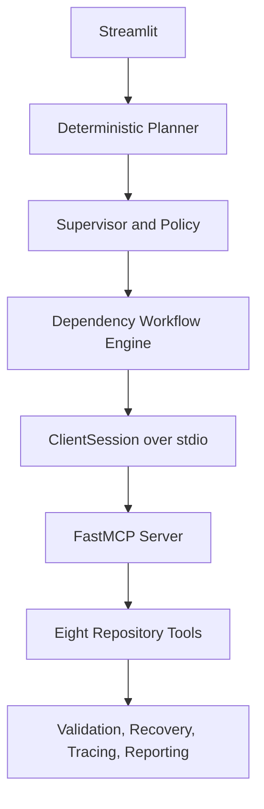

# DevFlow MCP

DevFlow MCP is a deterministic, offline Streamlit repository-health and release-readiness demonstrator for Lab 6. It uses a real FastMCP server process and `ClientSession` over stdio; the UI never calls repository tools directly.

## Setup

Windows PowerShell:

```powershell
python -m venv .venv
.\.venv\Scripts\Activate.ps1
python -m pip install -r requirements.txt
python -m pytest -q
streamlit run app.py
```

macOS/Linux:

```bash
python3 -m venv .venv
source .venv/bin/activate
python -m pip install -r requirements.txt
python -m pytest -q
streamlit run app.py
```

Set `DEVFLOW_ALLOWED_WORKSPACE_ROOT` to a trusted parent directory when auditing another project. The server remains the final path-security boundary. Tests execute repository Python code and therefore are not sandboxed by path checks or timeouts.

## Architecture



The eight registered tools are `list_project_files`, `read_project_file`, `search_code`, `analyze_python_project`, `inspect_test_inventory`, `run_project_tests`, `check_quality_rules`, and `generate_quality_report`. The Tool Explorer discovers these from `session.list_tools()`.

Independent inspection tasks run with bounded `asyncio.gather`; dependent testing and reporting are gated. DOP is the configured maximum independent concurrency and DOS is the count of dependency-bearing tasks. Tool validation, bounded retry, timeout protection, path security, structured logging, JSONL tracing, and measured performance monitoring are implemented in `core/` and `mcp_server/`.

## Evidence and reports

Traces append to `logs/mcp_traces.jsonl`, application logs to `logs/devflow.log`, and exported reports may be saved under `reports/`. The benchmark uses the same four read-only MCP calls sequentially and concurrently, measures with `perf_counter`, and reports mean, median, standard deviation, min/max, speedup, and percentage reduction. Parallel execution is not assumed to be faster.

## Demonstrations

Use `sample_quality_project` for a predictable passing audit. Point the approved path at an isolated fixture for failing tests, timeouts, traversal rejection, or dependency failure. A heuristic credential-like finding is evidence, not proof of a leaked secret; missing categories make the score explicitly inconclusive.
